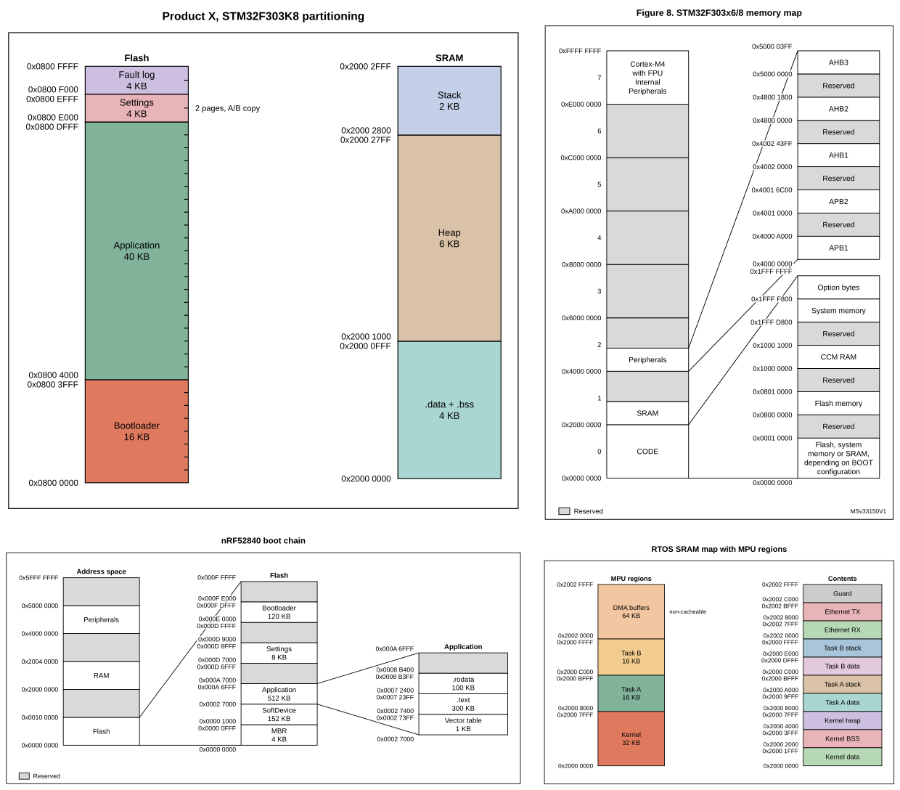

# memmap

Draw datasheet-style memory maps of MCU memory. You describe the layout in a YAML file, or
have `memmap` write that file from a linked firmware image or a flash partition layout. Either
way you get the same config, which `memmap` checks and renders to SVG, PNG or PDF.

- **Write it by hand.** One YAML file holds the memory (`memory`) and how to draw it (`view`),
  kept separate. Start from one of the [examples](#examples).
- **Generate it from firmware.** `from-elf` reads a linked ELF and the linker's map file (GNU ld,
  Keil armlink or IAR), and places every section at its real address and size in the chip's flash
  and RAM regions.
- **Generate it from a partition table.** `from-partitions` reads an ESP-IDF partition table, CSV
  or binary, and places every partition where the ESP-IDF build would. It also reads a Zephyr
  build's devicetree and an nRF Connect SDK Partition Manager layout, with MCUboot's slots marked.
- **Check before drawing.** Validation catches overlaps, overflow and flash sector misalignment,
  with the YAML path, line and a hint for each.
- **Verify as text.** Output is deterministic, and `describe` lists everything drawn, so agents and
  CI can check a drawing without looking at it.

Four memory maps drawn by `memmap`:



## Install

Each [GitHub release](https://github.com/iharhl/memmap/releases) has a wheel attached. To install
one with Python 3.10 or newer, without uv or a checkout:

```bash
pipx install https://github.com/iharhl/memmap/releases/download/v0.3.0/memmap-0.3.0-py3-none-any.whl
```

PNG and PDF output needs the `raster` extra and the system cairo library. SVG always works.

```bash
pipx install "memmap[raster] @ https://github.com/iharhl/memmap/releases/download/v0.3.0/memmap-0.3.0-py3-none-any.whl"
```

To work from a checkout instead, run `uv sync` (or `uv sync --extra raster`), and put `uv run` in
front of each `memmap` command below.

On macOS, Homebrew's cairo is not on the default library search path. Set this before rendering
PNG or PDF:

```bash
export DYLD_FALLBACK_LIBRARY_PATH=/opt/homebrew/lib
```

## Quick start

Choose a starting point. Each gives you a `layout.yaml`.

**A layout you are planning.** Copy the closest example:

```bash
cp examples/custom_bootloader.yaml layout.yaml
```

**A firmware image you have built.** Pass the ELF and the map file the linker wrote next to it:

```bash
memmap from-elf build/firmware.elf -o layout.yaml --map build/firmware.map
```

**An ESP-IDF project.** Pass its partition table and its `sdkconfig`:

```bash
memmap from-partitions partitions.csv -o layout.yaml --sdkconfig sdkconfig
```

**A Zephyr or nRF Connect SDK build.** Pass the merged devicetree, or the Partition Manager's
`partitions.yml`:

```bash
memmap from-partitions build/zephyr/zephyr.dts -o layout.yaml
```

Then check the config, see what will be drawn, and render it:

```bash
memmap check layout.yaml
```

```bash
memmap describe layout.yaml
```

```bash
memmap render layout.yaml -o layout.svg
```

## Writing a config

A minimal config, with a 64K flash split into a bootloader and an application:

```yaml
version: 1
figure: { title: "Flash layout" }
memory:
  regions:
    - id: flash
      start: 0x08000000
      size: 64K
      sectors: { size: 2K, count: 32 }
      children:
        - { id: boot, name: Bootloader, size: 16K }
        - { id: app, name: Application, size: auto }
view:
  defaults:
    labels:
      address: both
      size: true
    scale: { mode: linear }
  columns:
    - { id: flash_col, root: flash, title: Flash }
```

Children without a `start` are placed one after another, and `auto` takes what is left. Columns
take an optional `title`, drawn above them. For a detail column created by `view.expand`, set it
on the expansion: `expand: [{ region: flash, title: Flash }]`.

A config draws one address space. Memory the CPU does not map, such as an external SPI flash
whose offsets start at 0, goes in a top-level region with a `space`, so it may overlap the
others: `{ id: qspi, space: qspi, start: 0, size: 8M }`. A `/` column leaves such regions out,
so draw them in a column with their id as `root`. A config without `view.columns` gets one.

`memmap schema` prints every key with a description and an example. Point your editor's YAML
extension at it for completion. [AGENTS.md](AGENTS.md) has recipes for common tweaks.

## Generating a config from firmware

`from-elf` writes a config from the sections of a linked firmware image: `.text`, `.data`, `.bss`
and so on, each at its real address and size. The ELF does not record how big flash and RAM
are, so memmap reads the regions from the map file the linker writes:

| Toolchain | Map file | Usually in |
| --- | --- | --- |
| GNU ld: gcc, Zephyr, ESP-IDF, Pico SDK, STM32CubeIDE | `firmware.map` (`-Wl,-Map=`) | next to the ELF |
| Arm armlink: Keil MDK | `project.map` | `Listings/` |
| IAR ILINK | `project.map` | `List/` |

An lld map, as Rust and the LLVM Embedded Toolchain write, lists no regions. Give them with
`--region` instead, copying `ORIGIN` and `LENGTH` from the linker script's `MEMORY` block:

```bash
memmap from-elf build/firmware.elf -o layout.yaml --region flash=0x08000000:64K --region ram=0x20000000:20K
```

`--region` also works together with `--map`, to replace or add a region. The result is an
ordinary config: rename or merge blocks, add `view` options, then `render` it.
[docs/from-elf.md](docs/from-elf.md) covers what is read from each map, what happens when it is
not enough, and how sections become blocks.

## Generating a config from a partition layout

`from-partitions` draws a flash partition layout. It reads an ESP-IDF partition table, a Zephyr
build's merged devicetree or an nRF Connect SDK Partition Manager file, and tells them apart by
their content.

For an ESP-IDF project, it draws the bootloader, the partition table, each partition and the
free space between them. It reads the partition table CSV the project names in
`CONFIG_PARTITION_TABLE_FILENAME`, or the `build/partition_table/partition-table.bin` the build
writes. Partitions with a blank offset are placed as the build places them, so the
drawing matches the binary table.

The table does not record the flash size, so pass the project's `sdkconfig`, which also gives
the partition table and bootloader offsets. Without one, give the flash size:

```bash
memmap from-partitions partitions.csv -o layout.yaml --flash-size 4M
```

A CSV that breaks a rule of ESP-IDF's own table check gets W113, with a hint.

For Zephyr, pass `build/zephyr/zephyr.dts`, the devicetree the build merged. Each flash with
`fixed-partitions` gets a column, with MCUboot's slots marked. An external SPI or QSPI flash is
drawn from 0, in an address space of its own. For the nRF Connect SDK, pass
`build/partitions.yml` or a `pm_static.yml`: each region gets a column, and containers such as
`mcuboot_primary` are zoomed into. Neither needs options:

```bash
memmap from-partitions build/zephyr/zephyr.dts -o layout.yaml
```

[docs/from-partitions.md](docs/from-partitions.md) covers what is read and drawn, and the limits.

## Commands

| Command | Purpose |
| --- | --- |
| `memmap render CONFIG [-o OUT] [--format svg\|png\|pdf] [--json] [--strict] [--set key=value]` | Validate, then draw |
| `memmap check CONFIG [--json] [--strict]` | Validate only |
| `memmap describe CONFIG [--json]` | Resolved regions, blocks, labels and option origins |
| `memmap from-elf ELF [-o OUT] [--map FILE] [--region id=start:size[:name]] [--min-size N] [--force] [--json] [--strict]` | Write a config from a linked ELF, then check it |
| `memmap from-partitions TABLE [-o OUT] [--sdkconfig FILE] [--flash-size SIZE] [--table-offset OFFSET] [--bootloader-offset OFFSET] [--force] [--json] [--strict]` | Write a config from an ESP-IDF, Zephyr or Partition Manager partition layout, then check it |
| `memmap schema` | JSON Schema of the config |
| `memmap guide` | Print the agent guide, for agents using an installed copy |

`--strict` makes warnings fail the command. `--json` prints one result object on stdout, for
scripts and agents.

## Learn more

- [AGENTS.md](AGENTS.md): task guide, recipes and the full diagnostic list. `memmap guide` prints it.
- [docs/from-elf.md](docs/from-elf.md): drawing a linked firmware image, its map readers and limits.
- [docs/from-partitions.md](docs/from-partitions.md): drawing an ESP-IDF, Zephyr or Partition
  Manager partition layout.
- [Examples](#examples): one config per feature set, below.

## Examples

| Example | Shows |
| --- | --- |
| [custom_bootloader.yaml](examples/custom_bootloader.yaml) | Sequential placement, `auto` and `align: end`, sector checks, linear scale, colour palette |
| [stm32f303_fig8.yaml](examples/stm32f303_fig8.yaml) | Datasheet replica: numbered bands, zooms anchored to the top and bottom, `top_label`, legend |
| [stm32f051_fig10.yaml](examples/stm32f051_fig10.yaml) | Datasheet replica: reserved labels, staggered zooms with `anchor: free` and `offset` |
| [stm32f407_ota.yaml](examples/stm32f407_ota.yaml) | Mixed sector sizes, `fill_gaps: error`, weighted scale with `max_height`, notes |
| [nrf52840_boot_chain.yaml](examples/nrf52840_boot_chain.yaml) | Chained zooms, column `range`, per-column labels and scale, `start_of_next` |
| [riscv64_soc.yaml](examples/riscv64_soc.yaml) | 64-bit addresses, `collapse_reserved_over`, relative heights, style options |
| [rtos_mpu_ram.yaml](examples/rtos_mpu_ram.yaml) | `check_alignment`, `fill_gaps: none`, `depth`, two columns of one memory |
| [ota_package_format.yaml](examples/ota_package_format.yaml) | A file format instead of memory: `address: none`, byte sizes, a dashed zoom to the left |

To render them all into `build/`:

```bash
mkdir -p build
```

```bash
for f in examples/*.yaml; do uv run memmap render "$f" -o "build/$(basename "${f%.yaml}").svg"; done
```

## Develop

```bash
uv run pytest
```

Check types and style. mypy finds type errors, ruff finds missing annotations and lint issues:

```bash
uv run mypy
```

```bash
uv run ruff check
```

Golden SVGs live in `tests/golden/`. After an intended drawing change, review the diff and
regenerate them:

```bash
MEMMAP_UPDATE_GOLDEN=1 uv run pytest tests/test_golden.py
```

`from-elf` is also tested on real firmware images and linker maps, kept as small snapshots with
goldens. After an intended change to the importer, the map readers or the drawing, review and
regenerate those too:

```bash
MEMMAP_UPDATE_GOLDEN=1 uv run pytest tests/test_elf_snapshots.py tests/test_linker.py
```

`from-partitions` is tested on real ESP-IDF, Zephyr and nRF Connect SDK builds. The
`partition-table.bin` an ESP-IDF build wrote checks how memmap places the CSV, and the header a
Zephyr or Partition Manager build generated checks the addresses read. After an intended change
to it, review and regenerate:

```bash
MEMMAP_UPDATE_GOLDEN=1 uv run pytest tests/test_from_partitions.py tests/test_from_zephyr.py
```

[docs/from-elf.md](docs/from-elf.md#testing) explains the approach and shows the drawings.

Text is measured with a built-in Helvetica/Arial width table, so wrapping is slightly approximate
for other fonts.

To cut a release, see [RELEASING.md](RELEASING.md).
