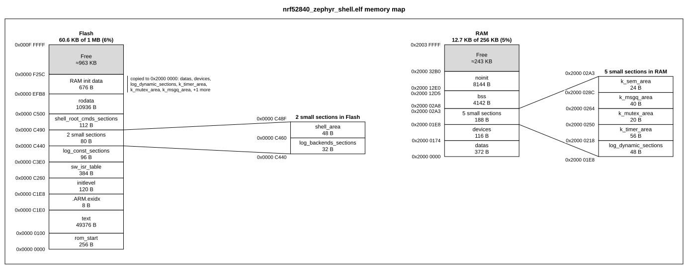
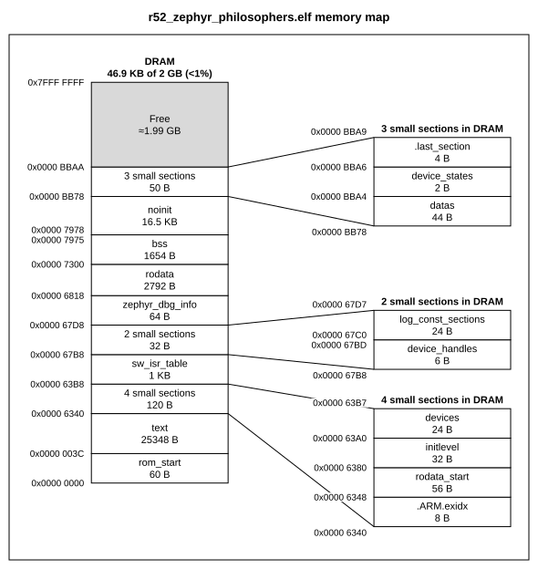
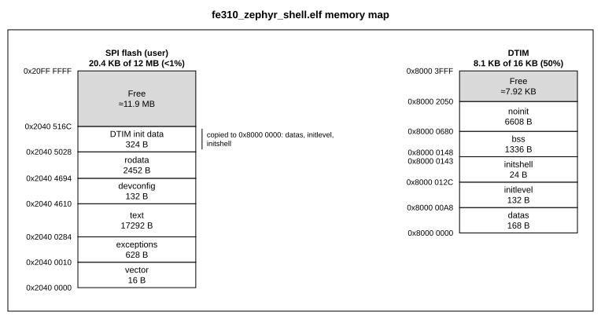
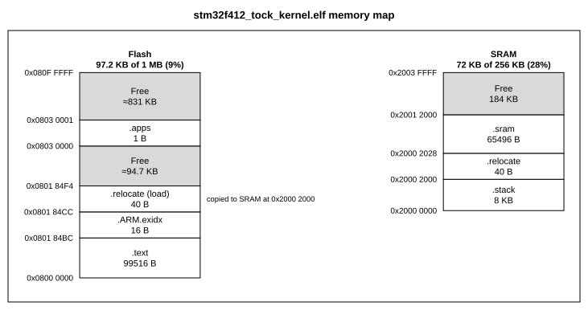
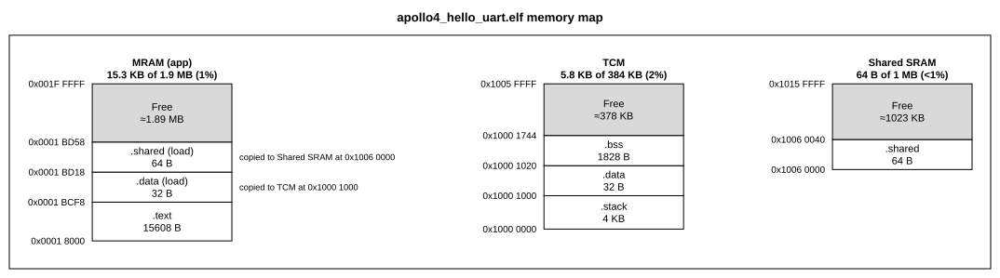
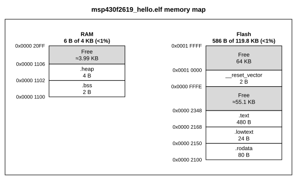
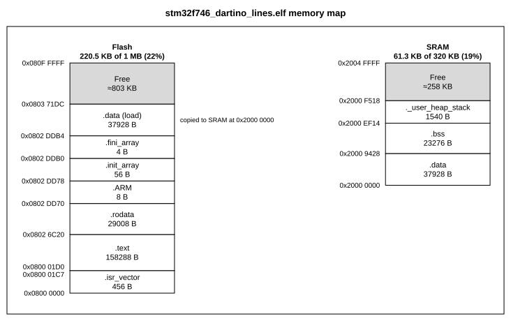
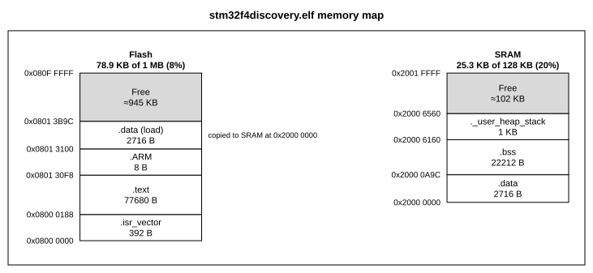

# Testing the ELF import

`memmap from-elf` makes judgement calls: which sections to draw, which to fold, where free space
goes, what to call the flash copy of `.data`. Those are easy to get wrong on layouts nobody
thought of, so besides hand-made cases the tests run real firmware through the importer.

## Test layers

| Layer | Where | Covers |
| --- | --- | --- |
| Synthetic ELFs | `tests/test_from_elf.py`, built by `tests/elf_builder.py` | One rule per test: folding, free gaps, load images, several memory banks, ids, 64-bit, big-endian, converted images, bad files, the CLI |
| Real builds | `tests/fixtures/firmware*.elf`, from `tests/fixtures/elf_src/` | The reader on files binutils wrote: one firmware as 32- and 64-bit, little- and big-endian. `build.sh` rebuilds them with `arm-none-eabi-gcc` and GNU `objcopy` |
| Real firmware | `tests/test_elf_snapshots.py`, `tests/fixtures/elf_snapshots/` | Nine images from different toolchains, OSes and architectures, against golden configs and drawings |

## Snapshots instead of ELF files

The real images total 6.6 MB, mostly debug info memmap never reads, and they are other projects'
builds. So the repo keeps a snapshot of each instead: the section headers, the loadable segments,
the `--region` specs to import with, and the source URL and SHA-256. That is 1 to 7 KB of JSON,
with no code or data from the firmware.

The test rebuilds each snapshot into a minimal ELF, imports it, and checks that the import reports
nothing, that the config matches `tests/golden/elf/<name>.yaml` and passes `check --strict`, and
that its drawing matches `tests/golden/elf/<name>.svg`. The configs from snapshots were identical
to those from the real files when the snapshots were made.

Snapshots cannot catch quirks in how a toolchain writes the file itself, as the rebuilt files are
clean. The real builds and the synthetic tests cover the reader.

## The images

All come from [Renode](https://github.com/renode/renode), whose board scripts
(`scripts/single-node/*.resc`) load prebuilt firmware from `dl.antmicro.com`. Locally they live
in `build/elf/`, which git ignores.

| Snapshot | Firmware | Regions |
| --- | --- | --- |
| `nrf52840_zephyr_shell` | Zephyr shell, nRF52840 (Cortex-M4) | flash 1M at 0, RAM 256K at 0x20000000 |
| `r52_zephyr_philosophers` | Zephyr philosophers, Cortex-R52 | DRAM 2G at 0 |
| `fe310_zephyr_shell` | Zephyr shell, SiFive FE310 (RISC-V), runs from SPI flash | SPI flash 12M at 0x20400000, DTIM 16K at 0x80000000 |
| `stm32f412_tock_kernel` | Tock (Rust) kernel, STM32F412 | flash 1M at 0x08000000, SRAM 256K at 0x20000000 |
| `hubris_stm32h753` | Hubris (Rust), STM32H753, a `.hex` converted to an object file | flash 2M at 0x08000000 |
| `msp430f2619_hello` | Hello world, MSP430F2619 (16-bit) | flash 0x1DF00 at 0x2100, RAM 4K at 0x1100 |
| `stm32f746_dartino_lines` | Dartino (Dart VM) demo, STM32F746 | flash 1M at 0x08000000, SRAM 320K at 0x20000000 |
| `stm32f4discovery` | STM32F4 Discovery demo, STM32F407 | flash 1M at 0x08000000, SRAM 128K at 0x20000000 |
| `apollo4_hello_uart` | AmbiqSuite hello world, Ambiq Apollo4 (Cortex-M4F) | MRAM 1952K at 0x18000, TCM 384K at 0x10000000, shared SRAM 1M at 0x10060000 |

The region sizes are the chips' real flash and RAM, from datasheets and Renode's platform files
(`platforms/cpus/*.repl`), since the ELF does not record them. Where the firmware starts above
the bottom of its memory, the region starts there too: the FE310 shell runs from the user part of
SPI flash, and the Apollo4 application starts 96 KB into its 2 MB MRAM.

## Refreshing and adding images

`tests/fixtures/elf_snapshots/refresh.py` lists the images with their URL, description and
`--region` specs, and rewrites every snapshot whose ELF is in `build/elf/`. `--download` fetches
the missing ones first:

```bash
uv run python tests/fixtures/elf_snapshots/refresh.py --download
```

To add an image, add it to `MANIFEST` in that script and run it. Then, as after any intended
change to the importer or the drawing, regenerate the goldens and review their diff:

```bash
MEMMAP_UPDATE_GOLDEN=1 uv run pytest tests/test_elf_snapshots.py
```

## The maps

These are the goldens, so they always show what the current code draws. Hubris is left out: its
converted image is one block.

### nRF52840, Zephyr shell

Two folded groups, each zoomed into, and one "RAM init data" block for the seven RAM sections
that startup code fills from flash.



### Cortex-R52, Zephyr philosophers

Three folded groups with a detail column each, in one 2 GB memory.



### FE310, Zephyr shell

RISC-V running from SPI flash, with data in the 16 KB DTIM.



### STM32F412, Tock kernel

A 1-byte `.apps` section far up flash, with free space on both sides.



### Apollo4, AmbiqSuite hello world

Three banks: code in MRAM, data in TCM and in shared SRAM. Each bank's initial data is copied
from MRAM in a segment of its own, and each copy's note names the bank it goes to.



### MSP430F2619, hello world

Small sections drawn in place, and the reset vector at 0xFFFE splitting flash in two.



### STM32F746, Dartino lines

A large `.data` copied from flash, and the stack and heap reserved as a section.



### STM32F4 Discovery demo

A conventional STM32 layout.


