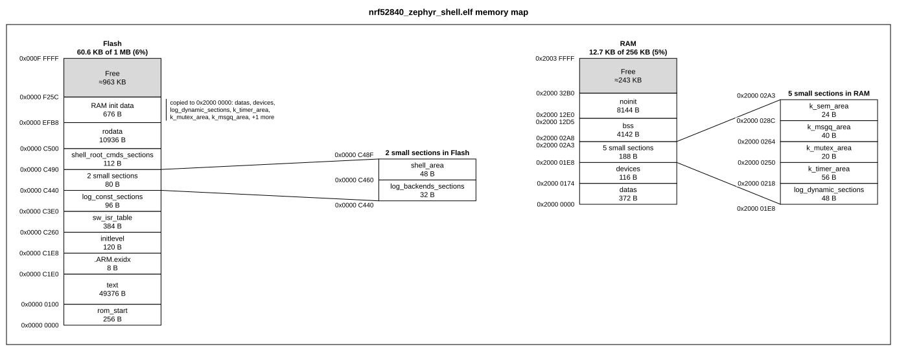
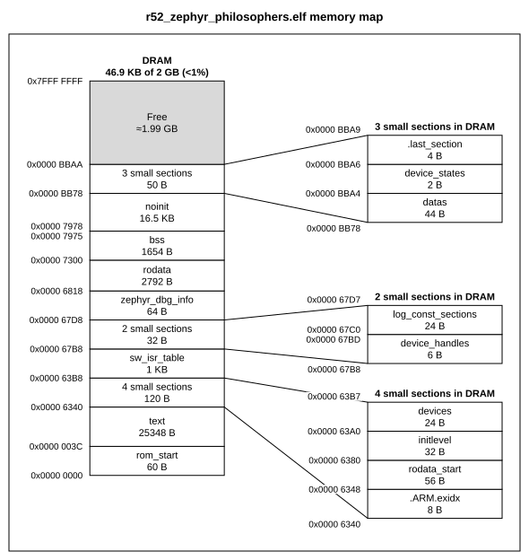
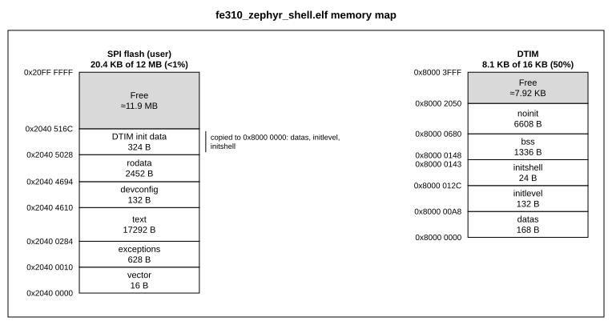
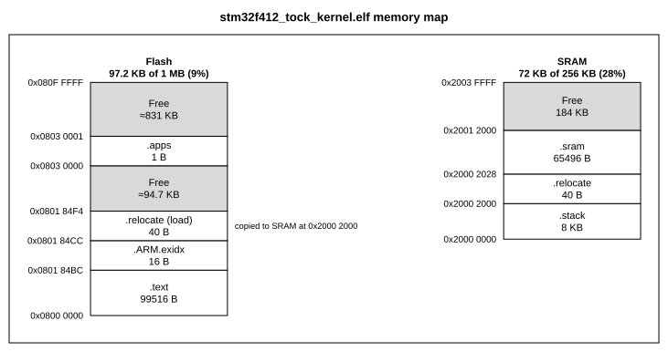
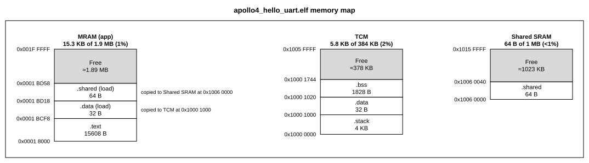
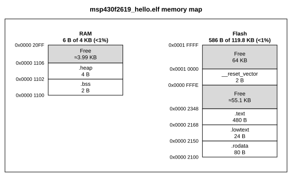
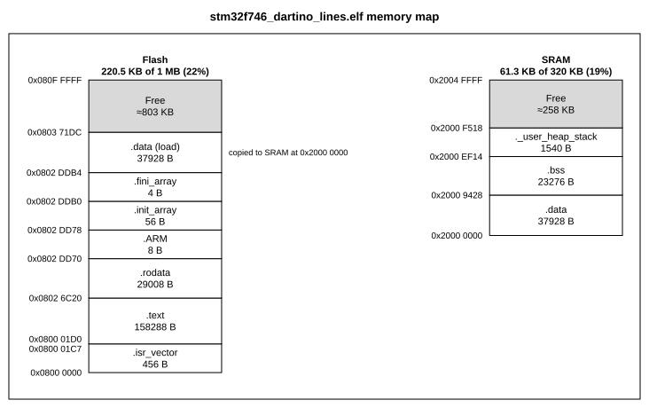
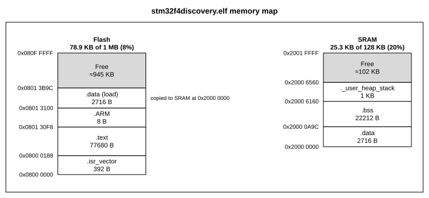
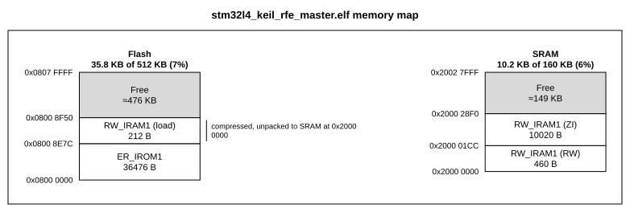
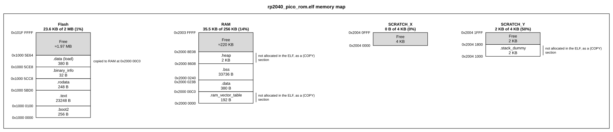

# Drawing a firmware image: `memmap from-elf`

`memmap from-elf` turns a linked firmware image into a memmap config: every allocated section
(`.text`, `.data`, `.bss` and so on) at its real address and size, placed in the chip's memory
regions. The config is then checked like `memmap check`, and you can edit and render it like
any other.

```bash
memmap from-elf build/firmware.elf -o layout.yaml --map build/firmware.map
memmap render layout.yaml -o layout.svg
```

The ELF says where every section is, but not how big flash and RAM are. That comes from the
map file the linker writes, or from `--region` specs you give by hand.

- [Where the regions come from](#where-the-regions-come-from)
- [Limits: when the map is not enough](#limits-when-the-map-is-not-enough)
- [From sections to blocks](#from-sections-to-blocks)
- [Future ideas](#future-ideas): Rust and lld, and what else is not covered yet
- [Testing](#testing)
- [The maps](#the-maps): the real-firmware goldens, drawn

## Where the regions come from

| Given | Regions |
| --- | --- |
| `--map FILE` | Read from the linker's map file |
| `--region ID=START:SIZE[:NAME]` | One per spec, such as `--region flash=0x08000000:64K:Flash` |
| Both | The map's, with each `--region` replacing the map region with its id, or adding one |
| Neither | None: sections are drawn on the whole address space |

### The map, by toolchain

| Toolchain | Turn the map on with | Usually at | What memmap reads |
| --- | --- | --- | --- |
| GNU ld: arm-none-eabi-gcc, Zephyr, ESP-IDF, Pico SDK, STM32CubeIDE | `-Wl,-Map=firmware.map` | next to the ELF | The Memory Configuration table: each `MEMORY` region with its origin and length |
| Arm armlink: Keil MDK, Arm Compiler 5 | `--map` (Keil's linker listing) | `Listings/` | Each execution region's base, and its `Max` as the size |
| IAR ILINK | `--map` (Linker > List > Generate linker map file) | `List/` | The address ranges of the placement summary |
| LLVM lld: Rust, LLVM Embedded Toolchain | `-Map`, but it lists no regions | | Nothing: give the regions with `--region` |

Zephyr, ESP-IDF and the Pico SDK write a map by default. memmap tells the formats apart by
their content, so the file name does not matter. Maps from armlink 5.05 and 5.06 are tested;
none from the armlink of Arm Compiler 6 is yet.

A map holds what the linker worked out: the `MEMORY` block after the preprocessor, `INCLUDE`
files and `--defsym` symbols are all applied. That is why memmap reads the map and not the
linker script, scatter file (`.sct`) or `.icf` file the linker was given. A linker script passed
to `--map` is turned away with a message saying so.

### Names and ids

Regions take their names from the map, and their ids from the names: `FLASH` gets the id
`flash`, `RAM_D1` gets `ram_d1`, and a repeated id gets a number, `ram_2`.

IAR maps do not name their regions. They list the address ranges each placement went to, which
are the `.icf` file's regions, worked out. memmap merges overlapping and adjoining ranges and
calls them by what is placed there: `RAM` when read-write data or a stack goes there, `ROM`
when only read-only content does, and `Memory` when the map does not say, as for a range that
holds named sections only. A comment at the top of the config says so. Repeated names are
numbered in address order, so on an STM32F407 with CCM RAM at 0x10000000, `ram` is the CCM and
`ram_2` the main SRAM: check the ids in the output before replacing one with `--region`.

### Mixing the map and `--region`

A `--region` with the id of a map region replaces it, which is how you correct one size or name:

```bash
memmap from-elf firmware.elf --map firmware.map --region flash=0x08000000:128K:Flash
```

A `--region` with a new id adds a region. To split a map region, give one of the parts its id,
so that it replaces the map region, and the others new ids:

```bash
memmap from-elf firmware.elf --map firmware.map --region flash=0x08000000:16K:Boot --region app=0x08004000:240K
```

With new ids for both parts, `FLASH` would overlap them and be left out with W112, which
`--strict` fails on.

### Regions left out, and regions without a column

| Map region | What happens | W112 |
| --- | --- | --- |
| Holds no section, such as an unused CCM RAM or Zephyr's `IDT_LIST` | Stays in `memory`, without a column | No |
| No size, such as an armlink region placed without a scatter file | Left out | Yes, with the `--region` to give, unless its start lies in a drawn region. One per start |
| Size 0 | Left out | No, as it holds nothing |
| Runs past the end of the ELF's address space | Left out | Yes, unless its start lies in a drawn region |
| Overlaps a `--region` | Left out | Yes, unless it lies inside the `--region` |
| Overlaps another map region, as when a script declares one RAM twice, for its instruction and data bus | Left out, unless it starts lower than the other or, at the same start, is larger or listed first | Yes, unless it lies inside the other |
| A section runs across its edge | Left out, and the sections placed again without it | Yes, with the `--region` to give |

W112 is reported only when the drawing loses something, and its hint says what to give
instead. Comments at the top of the config list every region left out and why, warned about or
not, and the `view` section names the regions without a column. To draw an empty region, add a
column with its id as root.

## Limits: when the map is not enough

> [!IMPORTANT]
> `from-elf` never makes up where a region starts or how big it is. When the map does not give
> a region it can draw, and no `--region` stands in, it writes nothing and exits 2 (E090 with
> `--json`), and the hint says which `--region` specs to give instead. When the map gives some
> regions but not the one a section is in, the region it left out gets W112 and the section
> W110, and the section is drawn outside every region. The one guess is a name: IAR maps name
> no regions, so memmap names them by what is placed there.

| Case | What the map holds | What `from-elf` does | What to give |
| --- | --- | --- | --- |
| lld: Rust (cortex-m-rt, Embassy, Tock), LLVM Embedded Toolchain | No region table at all | Stops | A `--region` per entry of the linker script's `MEMORY` block, such as `memory.x` |
| GNU ld, with a script that has no `MEMORY` block | Only the catch-all `*default*` region | Stops | A `--region` per memory |
| armlink without a scatter file, which places regions with `--ro-base` and `--rw-base` | Each region's base, but no `Max` | Stops, suggesting `--region er_ro=0x08000000:SIZE` for each start | The suggested specs, with sizes |
| armlink, with some regions given and one still without a size | | W112 on that region, with the `--region` that is missing, and W110 on its sections | That `--region` |
| armlink, with a tight `Max` on the code region | The RW load image placed after the code, past that `Max` | W112 on the region the load image runs across, and W110 on its sections | A `--region` with that region's id, large enough to hold it |
| IAR | Only the ranges content was placed in | A section placed at a fixed address outside them, such as a boot header, gets W110 | A `--region` that covers it |
| A map from another build | Regions that do not match the sections | W110 on every section | The map of this build |

A section that runs across the edge of a `--region` still stops the import, as only you can say
which edge is wrong.

For example, an lld map:

```text
$ memmap from-elf firmware.elf --map firmware.map
memmap: firmware.map is an lld map, which lists no memory regions
  hint: give each region with --region ID=START:SIZE, copying ORIGIN and LENGTH from the linker script's MEMORY block
```

A Rust `memory.x` such as

```text
MEMORY
{
  FLASH : ORIGIN = 0x00000000, LENGTH = 1024K
  RAM : ORIGIN = 0x20000000, LENGTH = 256K
}
```

becomes `--region flash=0x00000000:1024K --region ram=0x20000000:256K`. Passing the lld map as
well does no harm: its regions come from `--region`, and a comment says the map listed none.

W110 and W112 are warnings, so `from-elf` still writes the config and exits 0. Use `--strict`
to fail on them, as CI should.

Other things a map does not tell memmap:

- **Sub-regions.** Regions are flat. A bootloader and an application slot inside one `FLASH`
  region are one column; split it with `--region` as above, or nest blocks in the config
  afterwards.
- **What a region is for.** Names come from the map as written. Rename them in the config.
- **Overlays.** Of sections that share addresses, such as overlays and some `NOLOAD` sections,
  one is drawn; each that overlaps it gets W111 and is left out.

## From sections to blocks

- **Which sections.** Every allocated section with a size. The thread-local `.tbss` is skipped,
  as it only holds a template. A section the linker script reserves without allocating it, such
  as the RAM vector table, heap and stacks the Pico SDK declares as `(COPY)`, is drawn too when
  it lies inside a memory region and overlaps no allocated section, with the note `not
  allocated in the ELF, as a (COPY) section`. One at address 0 is left out, as it looks like a
  debug section there. Names lose the blanks IAR leaves around them.
- **Load images.** Initialised data is drawn twice: in RAM where it runs, and in flash where
  startup code copies it from. Each loadable segment stored away from where it runs is one flash
  block: `.data (load)` with a note such as `copied to RAM at 0x2000 0000`, or `RAM init data`
  when it holds several sections, as Zephyr's do, and `code and data` when it includes code.
- **armlink (Keil).** An execution region's RW and ZI data are two sections with one name, drawn
  as `RW_IRAM1 (RW)` and `RW_IRAM1 (ZI)`. armlink stores the RW data inside the segment of the
  code before it, so its flash copy, `RW_IRAM1 (load)`, is found from the segment rather than
  from a segment of its own. When armlink compresses RW data, as it does by default, the section
  header gives the compressed size and the ZI data starts further on than alignment explains:
  the RW data is then drawn up to the ZI data, and its flash copy is noted as compressed.
- **Free space.** Gaps of at least `--min-size` (default 64 bytes) become Free blocks with their
  size, rounded down and marked `≈` when not exact. Smaller gaps are drawn as a split edge.
- **Folding.** In a region of more than 8 blocks, runs of sections smaller than `--min-size`
  fold into one group, such as `5 small sections`, which keeps them as `children` and gets a
  detail column beside it. `--min-size 0` turns folding off.
- **Titles.** Each region's column is titled with its name and how much of it the sections
  use, such as `1.6 KB of 64 KB (3%)`.
- **Sections outside every region.** They are placed at the top level with W110, and the
  drawing becomes one column for the whole address space with each region zoomed out of it.
  Zooms go one level deep, so the regions' groups then list their sections in a note instead
  of a detail column.
- **No regions at all.** Sections are drawn on the whole address space. Object files converted
  from a `.hex` or `.bin` image, which keep their real addresses, are read too.

The output is an ordinary config. Rename, merge or annotate blocks freely, then `render` it.

## Future ideas

Not built yet, roughly in order of how many people they would help:

- **Rust and lld.** lld maps list no regions, so Rust firmware (cortex-m-rt, Embassy, RTIC,
  Tock) and the LLVM Embedded Toolchain need a `--region` per memory today. Nearly every Rust
  `memory.x` is a plain `MEMORY` block of literal origins and lengths, such as
  `FLASH : ORIGIN = 0x00000000, LENGTH = 1024K`. A reader for that alone could take regions from
  `memory.x` and turn away anything else (symbols, arithmetic, `INCLUDE`) with the `--region`
  to give instead, keeping the rule that memmap never works a region out itself. Another way in
  is the ELF: cortex-m-rt defines symbols such as `_stack_start` at the top of RAM, which give
  one edge of a region but not both.
- **armlink load regions.** A load region's `Max` bounds the whole flash image, including RW
  load data that runs past a tight execution region. Reading it would draw that image inside a
  region instead of leaving the region out.
- **Arm Compiler 6.** Its armlink is expected to write the same execution region lines as 5.06,
  but no AC6 map is tested yet.
- **Stable IAR ids.** Numbering repeated IAR names by size, the largest first, would make `ram`
  the main SRAM rather than whichever RAM range has the lowest address.
- **Splitting instead of dropping.** A `--region` inside a map region could cut the map region
  around it rather than leave it out, at the cost of drawing parts the map never named.

## Testing

`from-elf` makes judgement calls: which sections to draw, which to fold, where free space goes,
what to call the flash copy of `.data`, which map region to keep. Those are easy to get wrong
on layouts nobody thought of, so besides hand-made cases the tests run real firmware and real
maps through the importer.

| Layer | Where | Covers |
| --- | --- | --- |
| Synthetic ELFs | `tests/test_from_elf.py`, built by `tests/elf_builder.py` | One rule per test: folding, free gaps, load images, several memory banks, ids, 64-bit, big-endian, converted images, bad files, the CLI |
| Real builds | `tests/fixtures/firmware*.elf`, from `tests/fixtures/elf_src/` | The reader on files binutils wrote: one firmware as 32- and 64-bit, little- and big-endian, and its GNU ld map. `build.sh` rebuilds them with `arm-none-eabi-gcc` and GNU `objcopy` |
| Real firmware | `tests/test_elf_snapshots.py`, `tests/fixtures/elf_snapshots/` | Ten images from different toolchains, OSes and architectures, against golden configs and drawings |
| Linker maps | `tests/test_linker.py`, `tests/fixtures/linker_snapshots/` | The map readers on 13 real maps, against `tests/golden/linker/regions.json`, and every case of [the limits](#limits-when-the-map-is-not-enough): lld maps, maps without `MEMORY` or sizes, overlapping regions, sections across a region's edge, files that are not maps |

### Snapshots instead of ELF files

The real images total 6.5 MB, mostly debug info memmap never reads, and they are other projects'
builds. So the repo keeps a snapshot of each instead: the section headers, the loadable segments,
the `--region` specs to import with, and the source URL and SHA-256. That is 3 to 6 KB of JSON,
with no code or data from the firmware.

The test rebuilds each snapshot into a minimal ELF, imports it, and checks that the import reports
nothing, that the config matches `tests/golden/elf/<name>.yaml` and passes `check --strict`, and
that its drawing matches `tests/golden/elf/<name>.svg`. The configs from snapshots were identical
to those from the real files when the snapshots were made.

Snapshots cannot catch quirks in how a toolchain writes the file itself, as the rebuilt files are
clean. The real builds and the synthetic tests cover the reader.

### The images

Eight come from [Renode](https://github.com/renode/renode), whose board scripts
(`scripts/single-node/*.resc`) load prebuilt firmware from `dl.antmicro.com`. The other two are
builds committed to public repositories, pinned to a commit: a Keil one and a Pico SDK one,
whose layouts GNU ld builds do not show. Locally they live in `build/elf/`, which git ignores.

| Snapshot | Firmware | Regions |
| --- | --- | --- |
| `nrf52840_zephyr_shell` | Zephyr shell, nRF52840 (Cortex-M4) | flash 1M at 0, RAM 256K at 0x20000000 |
| `r52_zephyr_philosophers` | Zephyr philosophers, Cortex-R52 | DRAM 2G at 0 |
| `fe310_zephyr_shell` | Zephyr shell, SiFive FE310 (RISC-V), runs from SPI flash | SPI flash 12M at 0x20400000, DTIM 16K at 0x80000000 |
| `stm32f412_tock_kernel` | Tock (Rust) kernel, STM32F412 | flash 1M at 0x08000000, SRAM 256K at 0x20000000 |
| `msp430f2619_hello` | Hello world, MSP430F2619 (16-bit) | flash 0x1DF00 at 0x2100, RAM 4K at 0x1100 |
| `stm32f746_dartino_lines` | Dartino (Dart VM) demo, STM32F746 | flash 1M at 0x08000000, SRAM 320K at 0x20000000 |
| `stm32f4discovery` | STM32F4 Discovery demo, STM32F407 | flash 1M at 0x08000000, SRAM 128K at 0x20000000 |
| `apollo4_hello_uart` | AmbiqSuite hello world, Ambiq Apollo4 (Cortex-M4F) | MRAM 1952K at 0x18000, TCM 384K at 0x10000000, shared SRAM 1M at 0x10060000 |
| `stm32l4_keil_rfe_master` | [iCub](https://github.com/robotology/icub-firmware) RFE board, STM32L4, Keil armlink | flash 512K at 0x08000000, SRAM 160K at 0x20000000 |
| `rp2040_pico_rom` | [picoROM](https://github.com/nickbild/picoROM), RP2040, Pico SDK | flash 2M at 0x10000000, RAM 256K at 0x20000000, SCRATCH_X and SCRATCH_Y 4K each |

Only the ELF files are published, so the regions are `--region` specs: the chips' real
flash and RAM, from datasheets and Renode's platform files (`platforms/cpus/*.repl`), and for
the two repository builds the regions their committed linker maps give. Where the
firmware starts above the bottom of its memory, the region starts there too: the FE310 shell
runs from the user part of SPI flash, and the Apollo4 application starts 96 KB into its 2 MB
MRAM. The Tock kernel is linked by lld, so its regions would have to be given this way anyway.

To refresh the snapshots or add an image, see `tests/fixtures/elf_snapshots/refresh.py`. It
lists the images with their URL, description and `--region` specs, and rewrites every snapshot
whose ELF is in `build/elf/`; `--download` fetches the missing ones first. Then, as after any
intended change to the importer or the drawing, regenerate the goldens and review their diff:

```bash
uv run python tests/fixtures/elf_snapshots/refresh.py --download
MEMMAP_UPDATE_GOLDEN=1 uv run pytest tests/test_elf_snapshots.py
```

### Linker maps

The map readers are tested on real maps from public projects, chosen for the format variants
they show:

| Snapshots | Toolchain | Shows |
| --- | --- | --- |
| `zephyr_*.map` | GNU ld | Three Zephyr builds (nRF52832, ESP32, x86): Windows line ends, 64-bit wide addresses for a 32-bit target, Zephyr's `IDT_LIST` region |
| `keil_*.map` | armlink | Arm Compiler 5.05 `Base:` and 5.06 `Exec base:`, compressed RW data, an empty CCM region, regions with no `Max` |
| `iar*.map` | IAR ILINK | Versions 6 to 9, `'` digit groups, unions of ranges, `[0x0-0xff]` ranges on STM8, EEPROM with named sections only |

lld's map lists no regions, so it has no snapshot; the tests check that it is told apart and
that the import then asks for `--region`. The fixture firmware in `tests/fixtures/` has its GNU
ld map, which `build.sh` writes, and `--map` and the matching `--region` specs give the same
config.

A snapshot keeps only the lines the reader uses: the Memory Configuration table, the region
lines of an armlink map, the placement summary of an IAR map. Each starts with its source URL,
pinned to a commit, and `index.json` records the SHA-256 of each full file.
`tests/fixtures/linker_snapshots/refresh.py` rewrites them from the full files in
`build/linker/`, `--download` fetching the missing ones first. Where the full files are there,
the tests also check that each reads to the same regions as its snapshot.

To add a map, add it to `MANIFEST` in that script, run it, then regenerate the expected regions
and review their diff:

```bash
uv run python tests/fixtures/linker_snapshots/refresh.py --download
MEMMAP_UPDATE_GOLDEN=1 uv run pytest tests/test_linker.py
```

## The maps

These are the real-firmware goldens, so they always show what the current code draws.

### nRF52840, Zephyr shell

Two folded groups, each zoomed into, and one "RAM init data" block for the seven RAM sections
that startup code fills from flash.



### Cortex-R52, Zephyr philosophers

Three folded groups with a detail column each, in one 2 GB memory.



### FE310, Zephyr shell

RISC-V running from SPI flash, with data in the 16 KB DTIM.



### STM32F412, Tock kernel

A 1-byte `.apps` section far up flash, with free space on both sides.



### Apollo4, AmbiqSuite hello world

Three banks: code in MRAM, data in TCM and in shared SRAM. Each bank's initial data is copied
from MRAM in a segment of its own, and each copy's note names the bank it goes to.



### MSP430F2619, hello world

Small sections drawn in place, and the reset vector at 0xFFFE splitting flash in two.



### STM32F746, Dartino lines

A large `.data` copied from flash, and the stack and heap reserved as a section.



### STM32F4 Discovery demo

A conventional STM32 layout.



### STM32L4, Keil armlink

RW and ZI data under one name, drawn as `(RW)` and `(ZI)`, and the RW data stored compressed
after the code: 212 bytes in flash that unpack to 460 in SRAM.



### RP2040, Pico SDK

The RAM vector table, heap and core 0 stack are (COPY) sections, drawn with a note as they are
not allocated in the ELF.


