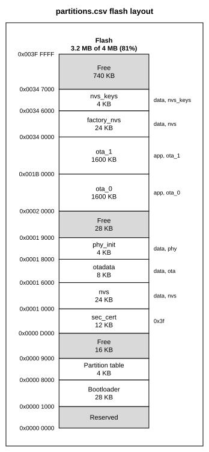

# Drawing a flash partition layout

`memmap from-partitions` writes a config from a flash partition layout. It reads three formats,
told apart by their content:

- an ESP-IDF partition table, CSV or binary: one flash column with the bootloader, the
  partition table, every partition and the free space between them;
- a Zephyr build's merged devicetree, `zephyr.dts`: a column per flash with partitions;
- an nRF Connect SDK Partition Manager file, `partitions.yml` or `pm_static.yml`: a column per
  memory region, with containers zoomed into.

```bash
memmap from-partitions partitions.csv -o layout.yaml --sdkconfig sdkconfig
```

```bash
memmap from-partitions build/zephyr/zephyr.dts -o layout.yaml
```



- [ESP-IDF](#esp-idf)
  - [What it reads](#what-it-reads)
  - [Where the settings come from](#where-the-settings-come-from)
  - [What is drawn](#what-is-drawn)
  - [Checks](#checks)
  - [Limits](#limits)
- [Zephyr devicetree](#zephyr-devicetree)
- [nRF Connect SDK Partition Manager](#nrf-connect-sdk-partition-manager)
- [Nesting and overlaps](#nesting-and-overlaps)
- [Testing](#testing)

## ESP-IDF

### What it reads

The table is either of the files ESP-IDF works from, told apart by their content:

| File | Where | Offsets |
| --- | --- | --- |
| Partition table CSV | the project, named by `CONFIG_PARTITION_TABLE_FILENAME` | worked out by memmap, as the build does |
| `partition-table.bin` | `build/partition_table/` | as the build wrote them |

A CSV has the columns `Name, Type, SubType, Offset, Size, Flags`, and memmap reads it the way
ESP-IDF's `gen_esp32part.py` does:

- Lines starting with `#` and blank lines are skipped. A header line without `#` is an error,
  as it is for the build.
- Numbers are Python integers, so `0x9000`, `36864`, `0o110000` and `0x9_000` all work, with an
  optional `K` or `M` suffix in either case.
- Types are `app`, `data`, `bootloader`, `partition_table` or a number. Subtypes are ESP-IDF's
  names, such as `ota_0`, `nvs` or `spiffs`, or a number. A subtype name that a component
  registers is kept as written.
- A blank offset follows the partition above it, aligned to 64K for an app and to 4K for
  anything else. The first one starts after the partition table. Partitions with offsets must
  be listed in address order, as the build places them in file order.
- A negative size gives the offset the partition ends at: `-0x400000` runs to the end of 4 MB.
- `bootloader` and `partition_table` entries with the `primary` subtype sit at the bootloader
  and partition table offsets, whatever their offset and size columns say.
- Flags are `encrypted` and `readonly`, separated by `:`.
- A byte order mark selects UTF-8, UTF-16 or UTF-32.

A binary table is a list of 32-byte entries with an MD5 entry and `0xFF` padding. memmap checks
the MD5 and reads the entries as they are.

### Where the settings come from

The table gives the partitions, but not how big the flash is, where the partition table sits or
where the ROM loads the bootloader from. memmap takes each from the options, else from the
`sdkconfig` given with `--sdkconfig`, else from a default:

| Setting | Option | sdkconfig | Default |
| --- | --- | --- | --- |
| Flash size | `--flash-size 4M` | `CONFIG_ESPTOOLPY_FLASHSIZE` | none: memmap stops and says what to give |
| Partition table offset | `--table-offset 0x8000` | `CONFIG_PARTITION_TABLE_OFFSET` | 0x8000 |
| Bootloader offset | `--bootloader-offset 0x1000` | `CONFIG_BOOTLOADER_OFFSET_IN_FLASH`, else the chip in `CONFIG_IDF_TARGET` | not known |
| Recovery bootloader | | `CONFIG_BOOTLOADER_RECOVERY_OFFSET` | none |
| Secure boot V1 | | `CONFIG_SECURE_BOOT_V1_ENABLED` | off |

The bootloader starts at 0x1000 on the ESP32 and ESP32-S2, at 0x2000 on the ESP32-C5, ESP32-H4,
ESP32-P4 and ESP32-S31, and at 0 on the other chips. A binary table with `primary` bootloader
or partition table entries gives those offsets itself; an option or sdkconfig that says
otherwise belongs to another build, and memmap stops. The header comments of the config say
which source gave each setting.

Projects without an sdkconfig, such as Arduino-ESP32 or PlatformIO ones, give the flash size
and, for a drawing that places the bootloader, `--bootloader-offset`.

When the flash size is missing and an `sdkconfig` lies next to the table, the hint names it.

### What is drawn

One region, `flash`, from 0 to the flash size. Offsets are positions in the flash chip, not the
addresses the CPU reads the flash through. Its blocks, in address order:

- `Reserved` below the bootloader, on a chip whose bootloader does not start at 0.
- `Bootloader`, from the bootloader offset up to the partition table. Without a known offset it
  starts at 0, with a note saying it starts at 0x0, 0x1000 or 0x2000 by chip.
- `Partition table`, one 4K sector.
- Each partition, named as in the table, with a note giving its type, subtype and flags, such as
  `app, ota_0` or `data, nvs_keys, encrypted`. A subtype left blank in a CSV is not shown, as
  its value depends on the ESP-IDF version.
- `Free` for the space between them, with its size.

A table that has its own `primary` bootloader or partition table entry is drawn with that entry
in place of the generated block. The region has 4K `sectors`, so `check` reports a partition
edge inside an erase sector as W100; the tick marks are turned off in `style`. The column title
gives how much of the flash the bootloader, the table and the partitions take.

### Checks

memmap stops, writing nothing, when the table cannot be drawn:

- the CSV cannot be read: an unknown type or flag, a blank type or size, a bad number;
- a partition starts before the end of the partition table, or overlaps one listed before it;
- a partition runs past the end of the flash, or has size 0;
- the partition table offset is 0, is not a multiple of 0x1000, or runs past the end of the
  flash, or the bootloader is not below it;
- a binary table's own bootloader or partition table entry disagrees with the options or the
  sdkconfig.

The message names the CSV line, and the hint says what to change. With `--json` it is E090.

A CSV that can be drawn but breaks a rule of ESP-IDF's own table check gets W113, which
`--strict` turns into a failure:

- an app starts off a 64K boundary, or anything else off a 4K one;
- an app's size is not a multiple of 4K, or of 64K with secure boot V1;
- a read-write NVS partition is smaller than 12K;
- `ota` or `coredump` data is marked `readonly`;
- there is more than one `otadata` or TEE `otadata` partition, or it is not 8K;
- two partitions share a name;
- a subtype name is not one ESP-IDF defines. The build accepts it only when a component
  registers it, so check the spelling.

Some of these rules are newer than others: a table that ESP-IDF 5.2 built can get W113 from a
rule added later. A binary table is not checked, as the build that wrote it checked it already.

### Limits

- **Environment variables.** The build expands `$NAME` and `${NAME}` in a CSV from the
  environment. memmap stops at any `$` followed by a name in a partition line, and asks for
  the value, so that the drawing does not depend on the shell it ran in.
- **Blank subtypes.** ESP-IDF 5 reads a blank subtype as `0x06`, undefined. Earlier versions
  read it as 0, which is also `otadata`'s subtype. memmap follows ESP-IDF 5.
- **Flash size `detect`.** Older sdkconfigs can leave the size to be detected when flashing.
  Give `--flash-size` then.
- **Other formats.** Arduino-ESP32, PlatformIO and MicroPython use ESP-IDF's CSV format, so
  their tables work too. Zephyr and Partition Manager layouts are covered below.
- **Table length.** ESP-IDF's binary table holds at most 95 entries. memmap does not check this.

## Zephyr devicetree

memmap reads the devicetree the build merged and preprocessed, `build/zephyr/zephyr.dts`, or
`build/<app>/zephyr/zephyr.dts` under sysbuild. A board `.dts`, an overlay or
`zephyr.dts.pre` needs the C preprocessor, includes and board files, so memmap stops on one and
asks for the merged file.

Every node with `compatible = "fixed-partitions"` lists the partitions of its parent, a flash
device, and each such flash becomes a region and a column:

| Flash | Example | Base and size |
| --- | --- | --- |
| Mapped by the CPU | `soc-nv-flash` on nRF, STM32, ESP32, RP2040 | its `reg`, mapped through the `ranges` above it, as Zephyr maps it |
| A chip on a SPI, QSPI or FlexSPI bus | `jedec,spi-nor`, `nordic,qspi-nor`, `nxp,imx-flexspi-nor` | from 0, with the size its `size` property gives in bits |

A bus flash has no CPU address: its region gets a `space` of its own, so it may overlap the
internal flash at 0. An older STM32 QSPI board gives the size in bytes as the second cell of
`reg`; memmap reads that too. A flash with neither is drawn up to its last partition.

- A partition's `reg` is an offset into its flash, so memmap adds the flash's base address. A
  `fixed-subpartitions` partition, as the nRF5340 and nRF91 boards use for TF-M, holds
  partitions whose `reg` its `ranges` maps; they are drawn inside it and zoomed into.
- Ids come from the node label (`slot0_partition`), names from the `label` property
  (`image-0`), else the node label.
- Notes give MCUboot's use of each partition, by the node labels Zephyr gives them. A board
  defines these partitions whether or not the build uses MCUboot, so the note says what the
  partition is for, not that MCUboot is there: `boot_partition` is
  MCUboot, `slotN_partition` a primary (even N) or secondary (odd N) slot of image N/2,
  `slotN_ns_partition` the non-secure image, `scratch_partition` the swap scratch area. A
  prefix such as `cpuapp_` is allowed. The partition that `/chosen/zephyr,code-partition`
  names is marked `code partition`, and a `read-only` one `read-only`.
- `erase-block-size` gives the region's `sectors`, so `check` reports a partition edge inside
  an erase block as W100. When the erase blocks do not divide the flash, or there would be more
  than 4096 of them, the region gets no `sectors`, and a header comment says so.
- A flash whose node, or a node above it, has `status = "disabled"` is still drawn, as its
  partitions still say how the flash is laid out, and the header says so.

The header comments say where each flash's base and size came from. memmap does not know which
upgrade mode MCUboot uses, so it checks no slot sizes. It does not mark the image header
(`CONFIG_ROM_START_OFFSET`) or the trailer either: neither is in the devicetree.

The ESP-IDF options do not apply, and memmap stops when one is given.

## nRF Connect SDK Partition Manager

An nRF Connect SDK build that uses the Partition Manager lays out flash in
`build/partitions.yml` (and `build/partitions_CPUNET.yml` for the nRF5340 network core), not
in the devicetree. A `pm_static.yml` has the same format. Each top-level key is a partition:

- `address`, `size` and `end_address` (exclusive). A size wins over an `end_address` that
  disagrees with it, and the header says so. A container that gives no address gets the range
  of the partitions it spans.
- `region`, `flash_primary` when left out. Each region becomes a region and column: Flash,
  External flash, SRAM, OTP, then others by name. The file does not say how big a region is,
  so each is drawn from its lowest to its highest partition.
- `span` makes the entry a container of the partitions it names, such as `mcuboot_primary`
  holding `mcuboot_pad` and `app`. It is drawn with them inside it and zoomed into. A
  container may span containers, listed in any order.
- A negative number, a `region` that is not a name, or an `end_address` below the `address`
  of an entry without a `size` stops the import. Flow style, `app: {address: 0x0, size: 0x1000}`, works too.
- `external_flash` is a chip, drawn in an address space of its own from its offsets. Any other
  region that overlaps one already drawn, such as `ram_flash`, gets one too.

Notes give the role of the partitions the nRF Connect SDK names: MCUboot and its slots,
`mcuboot_pad` (MCUboot image header), the nRF Secure Immutable Bootloader (`b0`, `s0`, `s1`),
TF-M and the application. A partition of size 0 is left out, with a header comment.

## Nesting and overlaps

memmap draws a tree, but both formats can list areas that overlap:

- An area inside another becomes its child, and the outer one gets a detail column.
- Areas with the same range become one block, named after the partition, with `also ...` in
  its note: Partition Manager's `tfm_nonsecure` spans exactly `app`.
- A partition that only partly overlaps another, or lies outside its flash, is left out with
  W114. A container that partly overlaps another is left out with a header comment, as it only
  groups partitions: with TF-M, `tfm_secure` straddles `mcuboot_primary_app`.
- In a `pm_static.yml`, `app` gives way to the partition or container it overlaps, with W114:
  the build places `app` in the space the others leave, so its entry there can be stale.
- W114 names the region in `subject`, and the partition by its devicetree line or its
  Partition Manager name.

## Testing

### ESP-IDF

`tests/test_from_partitions.py` runs on real tables, kept in `tests/fixtures/esp_partitions/`
with their sources and SHA-256 in `index.json`:

- **Builds.** Five ESP-IDF projects that committed their partition table, their `sdkconfig` and
  the `partition-table.bin` their build wrote. Between them: a partition table moved to 0x18000,
  a custom partition type with a blank subtype, blank offsets, rules that newer ESP-IDF added,
  a 1K partition, and bootloaders at 0x0, 0x1000 and 0x2000. The `.bin` is the ground truth:
  memmap's placement of the CSV must match it entry for entry. The sdkconfig keeps only the
  lines memmap reads.
- **Tables.** Two tables built into ESP-IDF, an ESP-IDF example with `bootloader` and
  `partition_table` entries, and the default tables of Arduino-ESP32 and MicroPython.

Each one is imported to a golden config in `tests/golden/partitions/`, and two builds are also
drawn to a golden SVG, as the drawing code is the same for every table. Each fixture shows
something the others do not; keep it that way. To add a table, add it to `refresh.py` in the
fixtures folder, then:

```bash
uv run python tests/fixtures/esp_partitions/refresh.py --download
```

```bash
MEMMAP_UPDATE_GOLDEN=1 uv run pytest tests/test_from_partitions.py
```

Before the fixtures were chosen, the same comparison ran on 121 ESP-IDF builds found on GitHub.
memmap placed 117 exactly as their `partition-table.bin`. Two differed only in a blank subtype,
which their older ESP-IDF read as 0. The `.bin` of the other two came from a different table
than the one committed, a build left stale.

### Zephyr and Partition Manager

`tests/test_from_zephyr.py` runs on real builds, kept in `tests/fixtures/zephyr_partitions/`
with their sources and SHA-256 in `index.json`:

- **Builds.** Three Zephyr builds that committed `zephyr.dts` with the
  `devicetree_generated.h` the build wrote from it, and one nRF Connect SDK build with
  `partitions.yml` and `pm_config.h`. The header is the ground truth: every partition and
  flash `reg` memmap reads must match its `DT_N_..._REG_IDX_0_VAL_ADDRESS` and `_SIZE` macros,
  and every Partition Manager entry its `PM_<NAME>_ADDRESS` and `_SIZE`. The headers keep only
  those lines. Between them: `fixed-subpartitions` mapped by `ranges` (nRF5340), a flash at
  0x10000000 through two levels of `ranges` with a FlexSPI NOR on a bus (NXP MCX N947), an
  STM32 at 0x08000000 with MCUboot's scratch partition and a QSPI NOR sized by its `reg`, and
  TF-M's nested containers with an external flash, OTP and a `ram_flash` region (nRF5340).
- **Tables.** A `pm_static.yml`, which no build generates a header from, whose stale `app`
  overlaps MCUboot: W114.

Each one is imported to a golden config in `tests/golden/partitions/`, and the MCX N947 and
nRF5340 Partition Manager builds are also drawn to a golden SVG. To add one, add it to
`refresh.py` in the fixtures folder, then:

```bash
uv run python tests/fixtures/zephyr_partitions/refresh.py --download
```

```bash
MEMMAP_UPDATE_GOLDEN=1 uv run pytest tests/test_from_zephyr.py
```

Before the fixtures were chosen, the same comparison ran on every build found on GitHub with
`gh search code` that committed both files:

- 1395 distinct `zephyr.dts` and header pairs from 311 repositories, 7521 `reg` entries: all
  match. In 8 of the pairs, from Zephyr 2.2, the header uses an older macro scheme that gives
  the flash's address but not the partitions'. A first run missed the `ranges` mapping, which
  showed as mismatches on the MCX N947 flash and on nRF5340 and nRF91 subpartitions.
- 222 distinct `partitions.yml` and `pm_config.h` pairs from 86 repositories, 2144 entries:
  all match.

A wider corpus then ran through the importer and `check`: 581 `zephyr.dts`, 98
`partitions.yml` and 368 `pm_static.yml` files from 458 repositories, distinct by content. None crashed. Each error
and warning was checked by hand:

- 36 devicetrees have no `fixed-partitions` node: nRF Connect SDK builds that use the
  Partition Manager, and ESP32, STM32 and RP2040 boards without partitions. Three `.yml` files
  were not Partition Manager files.
- W114 in 21 files, each a real problem: STM32 overlays whose MCUboot slots run past the flash
  (128 KB, or 808 KB on an STM32WB55 whose top holds the radio stack), two boards whose NOR
  `size` disagrees with their partitions (one an upstream Zephyr board), user overlays with
  partitions that partly overlap, and `pm_static.yml` files whose `app` overlaps MCUboot or
  outgrows its slot. Two of those are nRF Desktop configurations in the nRF Connect SDK itself,
  whose `app` is as big as the whole slot, header included; the build shrinks it.
- W100 in 27 files, each a real edge inside an erase block: RP2040's 256-byte second-stage
  bootloader, odd-sized Realtek partitions, STM32H7 partitions off its 128 KB blocks.
- W105 in 2 files: a name too long to fit the column without a break.
